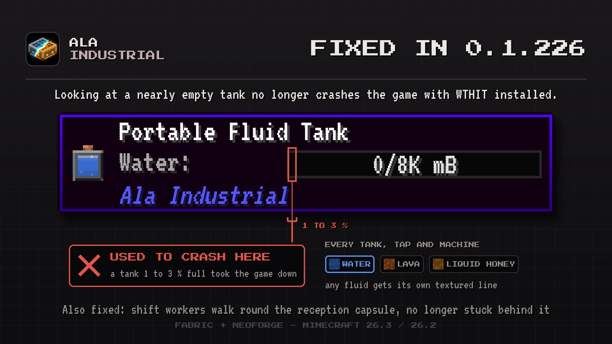

# Changelog

## 0.1.226

This update stops a crash with WTHIT on nearly empty tanks and helps shift workers reach the town hall.

### Bug Fixes

- Shift workers now walk round the reception capsule. A worker standing behind it no longer gets stuck against its back wall and misses the gathering in the town hall.
- **WTHIT and nearly empty tanks.** Looking at a tank 1 to 3 percent full no longer crashes the game with WTHIT. Every tank, tap and machine of the mod shows its fluid line as before.
