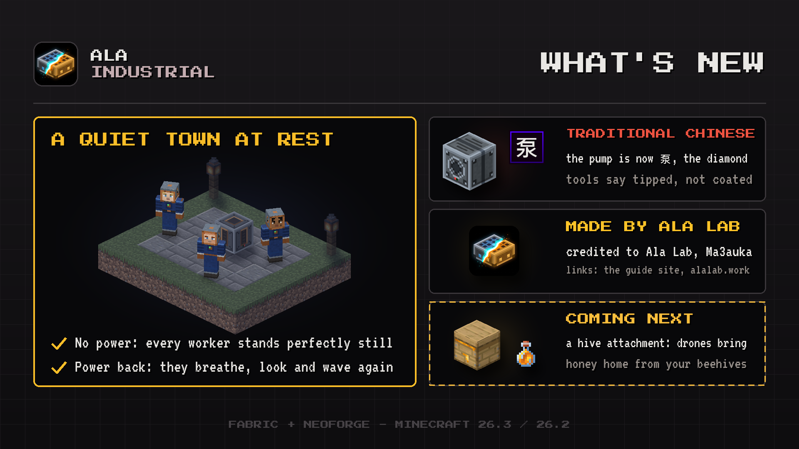

# Changelog

## 0.1.225

A small polish release: resting shift workers now stand perfectly still, Traditional Chinese names are fixed, and the mod is now credited to Ala Lab.

### Improved

- Traditional Chinese: the pump is now 泵, as in Simplified Chinese, and the three diamond-tipped tools
  say "tipped" rather than "coated".
- **The mod is now credited to Ala Lab.** The mod list shows "Ala Lab, Ma3auka" as the author, and its
  links now lead to the guide site and to the studio site, alalab.work.

### Bug Fixes

- A hibernating shift worker now stands still: its arms no longer sway.
