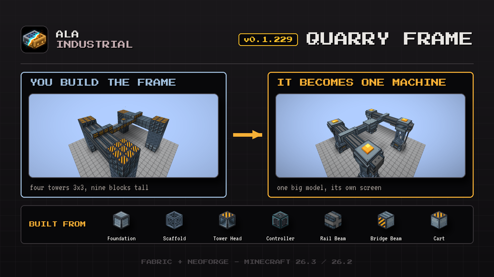

# Changelog

## 0.1.229

This update brings the quarry frame: build four towers and a bridge, and they become one big machine.

### New

- **Quarry frame.** Build a huge portal frame of four towers and it becomes one machine with its own screen, powered through its main tower. Digging arrives in a later update.
