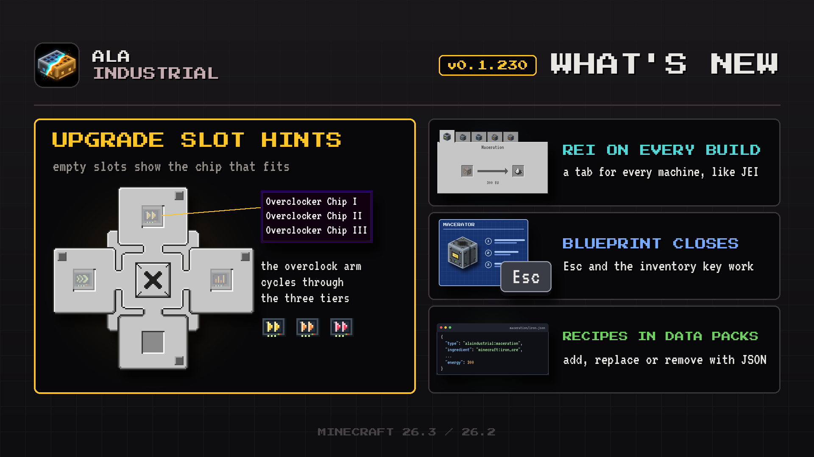

# Changelog

## 0.1.230

This update brings the fixes players asked for: machine recipes in REI everywhere, hints in empty upgrade slots and a blueprint sheet that closes properly.

### Improved

- **Data pack recipes.** Machine recipes load from data packs, so a pack can add, replace or remove them, and tests now cover it.
- **Upgrade slot hints.** Empty slots of the upgrade panel show a faint icon of the chip that fits, and hovering one names the chips it takes.

### Bug Fixes

- **REI everywhere.** Machine recipes now show up in REI in every build of the mod, with a tab for every machine, just like in JEI.
- **Blueprint sheet closes.** The blueprint sheet now closes with Esc and with the inventory key, back to the screen it was opened from.
