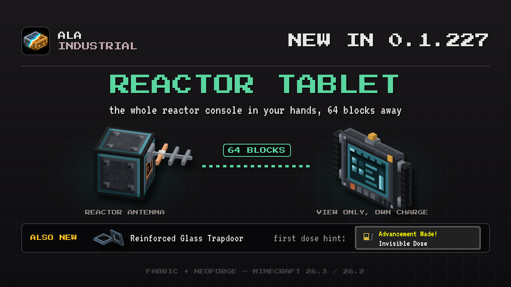

# Changelog

## 0.1.227

This update brings the reactor tablet: watch your whole reactor from 64 blocks away through an antenna in its wall.

### New

- **Reinforced Glass Trapdoor.** A steel frame round a see-through glass pane that opens by hand or by redstone, as tough as Reinforced Glass.
- Your first dose of radiation earns the "Invisible Dose" advancement: its toast explains the radiation icon and points you to the Geiger counter. It shows once and is not announced in chat.
- **Reactor antenna and tablet.** An antenna set into the reactor room's wall sends the reactor's screen to a tablet within 64 blocks, view only. Without a signal the tablet shows interference and why.
- **The reactor tablet in your hands.** Both hands lift it and its screen unfolds to almost fill the view. Its lamps glow red while the reactor is in danger, even in the hotbar, and it shows its charge.
