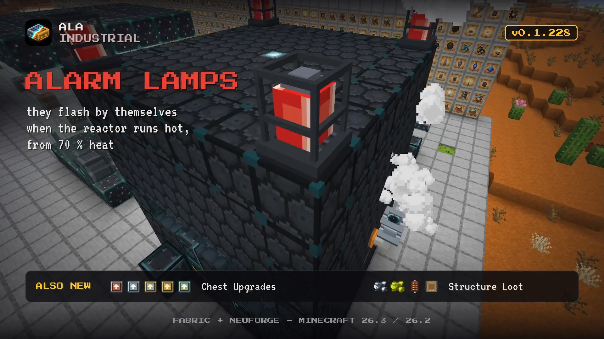

# Changelog

## 0.1.228

The reactor now warns you itself: alarm lamps flash red when it runs hot, and chests upgrade in place.

### New

- **Structure loot.** Mineshaft, dungeon and village toolsmith chests can now hold mod items such as tin, sulfur, rubber and kok-sagyz seeds. A config switch turns it off.
- **Chest Upgrades.** Shift and right-click a placed chest to raise it one tier, from copper to diamond, with every item kept in its slot. A double chest takes two.
- **Reactor Alarm Lamp.** A red flashing beacon for any face that lights up by itself on a hot reactor or follows any redstone. The antenna boom now outputs redstone 0, 7 or 15.
